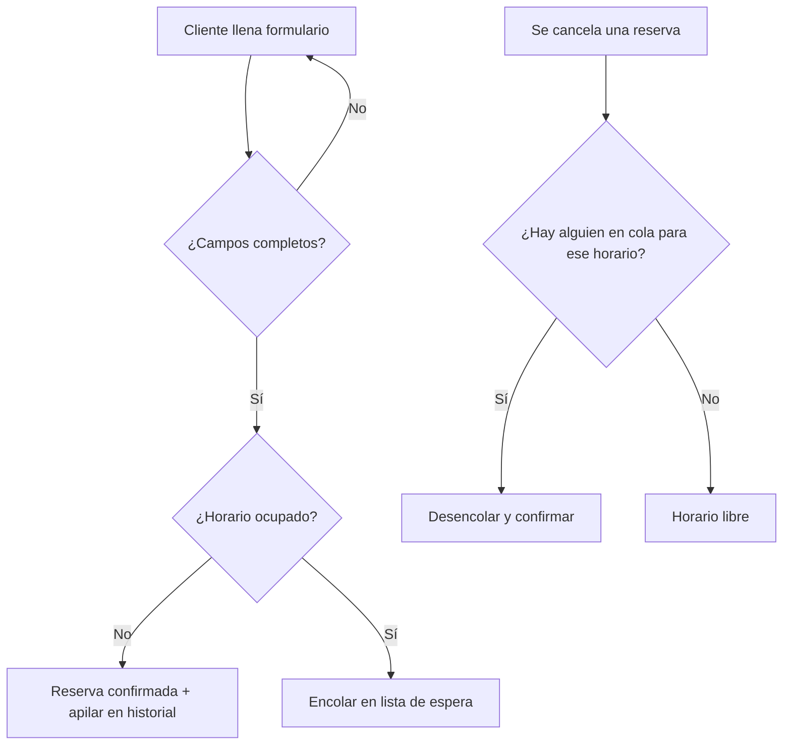

# Historias de usuario (Integrante 4)
- Como cliente, quiero reservar una cancha en fecha y hora para asegurar mi partido.
- Como cliente, quiero entrar a una lista de espera si el horario está ocupado para tener otra oportunidad.
- Como administrador, quiero que al cancelarse una reserva pase automáticamente la siguiente en la cola.
- Como administrador, quiero ver el historial de abonos y confirmaciones recientes, y deshacer el último.

# Requisitos funcionales
- RF1: Registrar reserva (id, cliente, fecha, hora, cancha, estado).
- RF2: Detectar cruce de horarios y encolar la solicitud (Cola FIFO).
- RF3: Al cancelar, desencolar y confirmar al primero en espera del mismo horario.
- RF4: Registrar abonos y confirmaciones en un historial (Pila LIFO).
- RF5: Deshacer el último movimiento del historial (pop).

# Requisitos no funcionales
- RNF1: Interfaz usable en celular y computadora.
- RNF2: Datos en memoria (se reinician al apagar el servidor).
- RNF3: Respuesta de la interfaz en menos de 1 segundo.

# Diagrama de flujo (reservar)

